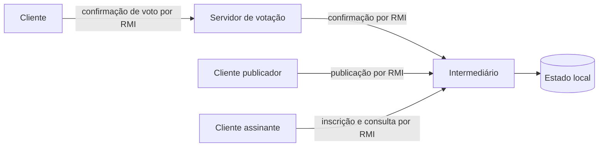

# Notificações de votação

Sistema de comunicados do Trabalho 3 de Sistemas Distribuídos. O sistema usa **publicar–assinar por rótulos, com um intermediário central**, e executa o servidor de votação, o intermediário e os clientes em processos Java separados.

- [Compilação, execução em duas máquinas e testes](servidor/README.md)
- [Fluxo, comandos e arquivos Java](servidor/src/votacao/README.md)
- [Diagrama de classes](servidor/diagrama-classes.md)

## Arquitetura

No Trabalho 2, o servidor mantinha referências RMI dos clientes e chamava cada cliente diretamente para entregar um aviso. No Trabalho 4, o servidor e os clientes se comunicam com o intermediário. RMI transporta o envio de comandos e a leitura dos recibos. O intermediário faz a distribuição por tópico e mantém as pendências em disco local.

Cada rótulo combina tipo e identificador. `VOTACAO/turma`, `VOTACAO/diretoria` e `NOTIFICACAO/turma` têm assinaturas independentes. Uma confirmação cria ou reutiliza a assinatura da pessoa no tópico da votação. Grupos de notificação aceitam assinaturas voluntárias. O projeto demonstra confirmações de voto e comunicados. As classes de eleitor, candidato e votação representam o domínio, e a aplicação não cadastra eleições nem apura votos.

## Relatório técnico

**Desacoplamento espacial.** A publicação contém o rótulo e a mensagem. O publicador configura o endereço do intermediário. Os assinantes são localizados pelo índice de tópicos do intermediário, que guarda os avisos por ID de assinatura.

**Desacoplamento temporal.** O publicador recebe um protocolo quando o intermediário grava o comando em sua fila. Essa chamada RMI espera a confirmação do intermediário. A entrega aos assinantes é assíncrona. O cliente pode fechar a sessão e consultar os avisos mais tarde. Para aceitar uma nova publicação, o intermediário precisa estar acessível. O servidor de votação também depende dele para encaminhar confirmações.

**Recuperação.** Comandos aceitos e avisos pendentes ficam no disco do intermediário. Ao reiniciar com o mesmo diretório, ele retoma o processamento. O último protocolo e seu resultado são gravados junto ao estado para recompor o recibo em caso de interrupção. Uma consulta consome os avisos da assinatura. O resultado segue consultável pelo protocolo do recibo. O acompanhamento automático não mostra o protocolo de cada consulta.

**Custo.** Além das chamadas RMI, a fila e os recibos exigem gravações em disco. O intermediário carrega e regrava o estado a cada comando. O índice limita a distribuição ao rótulo de destino, com uma inserção por assinatura correspondente. O log mede o tempo de processamento da publicação no intermediário. Compare várias rodadas com a mesma mensagem e números diferentes de assinantes. Meça separadamente o tempo até exibir o aviso no cliente, que inclui a rede e a espera pela próxima consulta.
