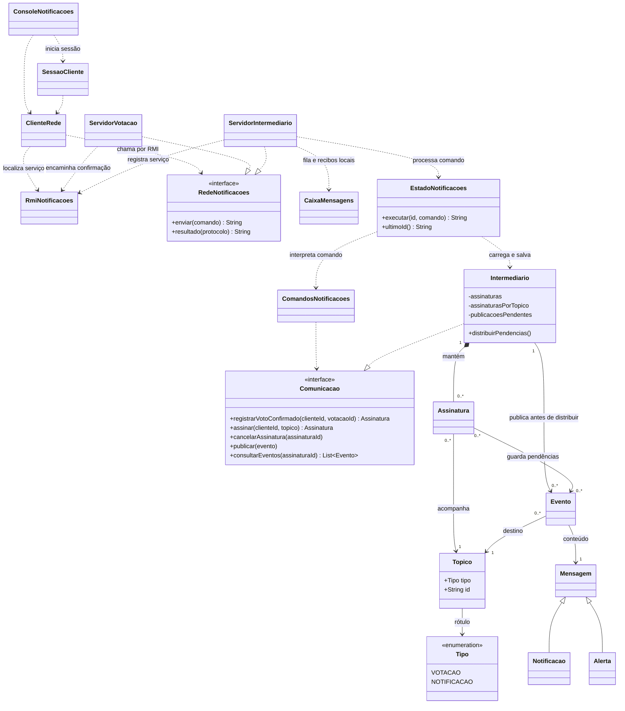

# Diagrama de classes do Trabalho 4

O diagrama mostra as classes que participam do fluxo de comunicação. `Votacao`, `Candidato` e `Eleitor` continuam no código como entidades do domínio. A confirmação recebe IDs e o fluxo de avisos usa esses IDs sem instanciar essas entidades.

