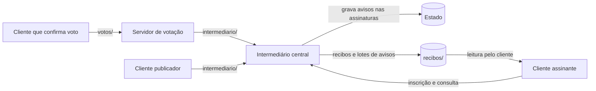

# Como funciona o sistema de notificações de votação

Este documento descreve a implementação do Trabalho 4. Para compilar e iniciar os processos, consulte o [guia de execução](../../README.md). Os comandos dos exemplos abaixo são digitados dentro de uma sessão do cliente.

## Visão geral

O sistema tem um servidor de votação, um intermediário central e uma ou mais instâncias do cliente. Um cliente pode publicar avisos, acompanhá-los ou fazer as duas coisas. Os processos permanecem em execução até serem encerrados e trocam mensagens por um diretório compartilhado.

| Processo | O que faz enquanto está aberto |
|---|---|
| **Servidor de votação** | Verifica a caixa `votos/`, encaminha as confirmações para a caixa do intermediário e espera 250 ms antes de verificar de novo. |
| **Intermediário** | Processa os comandos de `intermediario/`, atualiza o estado, grava os recibos e espera 250 ms entre rodadas. Ao publicar, encaminha o evento às assinaturas que correspondem ao rótulo. |
| **Cliente** | Lê os comandos digitados, verifica recibos em segundo plano com uma pausa de 250 ms e, quando o acompanhamento está ativo, consulta os avisos com uma pausa de 2 s entre verificações. |

**O servidor não cria avisos periódicos.** A espera de 250 ms serve para evitar que cada servidor consulte o diretório continuamente. O aviso nasce de um comando `publicar`. Em `acompanhar`, é o cliente que verifica os avisos pendentes. Esses intervalos são pausas na execução, por isso o tempo total até exibir um aviso pode ser maior.

## Votações, grupos e rótulos

Um rótulo identifica o destino e combina um tipo com um nome. `VOTACAO/turma` e `NOTIFICACAO/turma` são destinos distintos. O tipo do destino é independente da categoria da mensagem. Por exemplo, um `ALERTA` pode ser publicado para uma votação ou para um grupo.

- **Votação.** `voto-confirmado ana turma` simula a chegada da confirmação de um voto e inscreve Ana em `VOTACAO/turma`. Não é preciso cadastrar `turma` antes. O fluxo usa o texto como identificador. Ele não valida eleição, eleitor ou candidato, nem registra uma escolha ou apura votos.
- **Grupo de notificação.** `assinar ana calendario` inscreve Ana em `NOTIFICACAO/calendario`. Também não há cadastro prévio do grupo. A inscrição é voluntária e independe de confirmação de voto.
- **Correspondência.** O intermediário compara tipo e nome do destino exatamente. Se Ana e Bia estiverem inscritas em `VOTACAO/turma`, ambas recebem o aviso. Uma pessoa inscrita apenas em `NOTIFICACAO/turma` não o recebe. Só as assinaturas ativas no momento do processamento recebem o evento. Se não houver assinantes, o comando pode ser processado com sucesso, mas o aviso não será entregue a quem se inscrever depois.

## Comandos do cliente

O cabeçalho `ConsoleNotificacoes <diretório de mensagens> [comando]` descreve a inicialização. Informe o diretório ao iniciar o Java. O argumento `[comando]` é opcional. Quando omitido, o cliente abre uma sessão para digitar vários comandos. Quando informado, o cliente executa a operação avulsa. No modo de sessão, os sinais `< >` indicam valores que devem ser substituídos e o texto de uma publicação pode ser digitado sem aspas.

| Comando na sessão | O que faz |
|---|---|
| `voto-confirmado ana turma` | Envia a confirmação ao servidor de votação. Depois do encaminhamento, o intermediário cria ou reutiliza a inscrição de Ana em `VOTACAO/turma`. O recibo contém o ID da assinatura. |
| `assinar ana calendario` | Pede diretamente ao intermediário uma inscrição em `NOTIFICACAO/calendario`. Repetir a inscrição da mesma pessoa no mesmo tópico ativo retorna o mesmo ID. |
| `publicar VOTACAO turma ALERTA Restam cinco minutos.` | Enfileira um aviso para `VOTACAO/turma`. O primeiro tipo indica o destino. O segundo, `ALERTA`, indica a categoria do texto. As categorias aceitas são `ALERTA`, `NOTIFICACAO` e `ATUALIZACAO`. |
| `consultar <id-da-assinatura>` | Solicita um lote com todos os avisos pendentes daquela assinatura. A operação retira esse lote da caixa. Se ninguém publicar outro aviso, a próxima consulta vem vazia. |
| `resultado <id-do-comando>` | Lê o recibo de um comando já enviado. Exibe `Pendente.` se o arquivo ainda não estiver disponível. Consultar o mesmo recibo novamente não consome o arquivo. |
| `acompanhar <id-da-assinatura>` | Ativa a consulta automática de uma assinatura na sessão. É possível continuar digitando comandos enquanto os avisos aparecem. A sessão acompanha uma assinatura por vez. |
| `cancelar <id-da-assinatura>` | Remove a assinatura no intermediário e descarta os avisos que ainda estavam pendentes nela. Para voltar a receber avisos daquele tópico, faça uma nova inscrição. |
| `parar-acompanhamento` | Para de iniciar novas consultas automáticas na sessão. Uma consulta já enfileirada ainda pode ter resultado. A assinatura continua ativa e o intermediário continua guardando os novos avisos. |
| `sair` | Fecha a sessão do cliente. As assinaturas permanecem registradas. |
| `ajuda` | Exibe os comandos disponíveis. |

**Dois identificadores aparecem no console.** O valor após `Enfileirado:` é o protocolo daquele comando. Use-o com `resultado`. O valor exibido depois de `[voto-confirmado]` ou `[assinar]` é o ID da assinatura. Use-o com `consultar`, `acompanhar` e `cancelar`. Na sessão interativa, os recibos de comandos enviados nela também aparecem automaticamente.

## Fluxo completo de um aviso

1. Ana digita `voto-confirmado ana turma`. O cliente grava o comando em `votos/` e mostra o protocolo de envio.
2. O servidor de votação move o arquivo para `intermediario/` com o mesmo protocolo. O intermediário cria a assinatura e grava o ID no recibo. O cliente de Ana exibe esse ID.
3. Outro cliente digita `publicar VOTACAO turma ALERTA Restam cinco minutos.`. Esse comando vai direto para a caixa do intermediário. O protocolo indica que o comando entrou na fila. O recibo de publicação confirma o processamento, sem indicar que alguém já leu o aviso.
4. O intermediário procura as inscrições de `VOTACAO/turma` e guarda o evento na lista de pendências de cada inscrito. O publicador não precisa saber quem está inscrito nem esperar alguém abrir o cliente.
5. Ana digita `acompanhar <id-da-assinatura>`. O cliente enfileira consultas periódicas, mantendo no máximo uma consulta automática em andamento. O intermediário retira os avisos da assinatura e escreve o lote em um recibo. O cliente lê o recibo e mostra o alerta.

Se Ana sair depois de obter a assinatura, outro cliente ainda pode publicar. Ao reabrir a sessão, ela usa o mesmo ID para consultar os avisos que ficaram pendentes. Se o próprio intermediário estiver parado, a publicação aguarda em `intermediario/` até ele voltar. Uma confirmação aguarda primeiro em `votos/` se o servidor de votação estiver parado.

Para testar, confirme o voto e aguarde o ID antes de publicar. Assim a inscrição já estará ativa quando o aviso for processado. Guarde o ID, encerre o assinante, publique no outro cliente, volte a abrir o assinante e execute `consultar <id-da-assinatura>`. Faça a mesma consulta novamente para observar o consumo do lote.

## Estrutura do diretório compartilhado

| Arquivo ou pasta | Conteúdo |
|---|---|
| `votos/` | Confirmações aguardando encaminhamento pelo servidor de votação. |
| `intermediario/` | Comandos aguardando processamento pelo intermediário, incluindo as confirmações encaminhadas. |
| `recibos/` | Resultados indexados pelo protocolo do comando. Os recibos ficam no disco. |
| `estado.bin` | Estado do intermediário, com assinaturas, avisos pendentes e o resultado do último comando. |
| `estado.lock` | Arquivo usado para impedir que dois intermediários processem a mesma caixa ao mesmo tempo. |

Os comandos e recibos são arquivos de texto. A gravação passa por um arquivo temporário, que é renomeado de forma atômica depois de pronto. O estado é salvo separadamente em formato binário. Ao reiniciar no mesmo diretório, o intermediário recupera a operação gravada no estado se ela ainda estiver na entrada. Se um aviso já foi retirado por uma consulta mas ainda não apareceu na tela, ele fica no recibo daquela consulta e não retorna pela próxima. A consulta manual mostra o protocolo para recuperar esse recibo. No acompanhamento automático, o cliente não exibe o protocolo de cada consulta.

## Arquivos Java

O pacote `console` contém as entradas dos processos, a leitura dos comandos, o transporte por arquivos e a persistência.

| Arquivo | Responsabilidade |
|---|---|
| [ConsoleNotificacoes.java](console/ConsoleNotificacoes.java) | Ponto de entrada do cliente. Escolhe entre sessão interativa e comando avulso, valida a operação e envia confirmações à caixa de votação e os demais comandos à caixa do intermediário. |
| [SessaoCliente.java](console/SessaoCliente.java) | Lê comandos do teclado, acompanha recibos de comandos enviados na sessão e consulta periodicamente a assinatura selecionada em segundo plano. |
| [ServidorVotacao.java](console/ServidorVotacao.java) | Ponto de entrada do servidor de votação. Faz a ponte de `votos/` para `intermediario/`, preservando o protocolo de cada confirmação. |
| [ServidorIntermediario.java](console/ServidorIntermediario.java) | Ponto de entrada do intermediário. Obtém o bloqueio, lê os comandos da sua caixa, pede a execução ao estado, grava recibos, remove os comandos processados e registra o tempo das publicações. |
| [CaixaMensagens.java](console/CaixaMensagens.java) | Cria protocolos com data em milissegundos e UUID. Grava e lista entradas, encaminha arquivos entre caixas e grava ou recupera recibos. |
| [ComandosNotificacoes.java](console/ComandosNotificacoes.java) | Interpreta os argumentos e os converte em operações de `Comunicacao`. Cria os tópicos e as mensagens usados na publicação e formata a exibição dos avisos. |
| [EstadoNotificacoes.java](console/EstadoNotificacoes.java) | Carrega e salva `estado.bin`, executa cada comando sobre o intermediário, distribui as pendências e registra o último protocolo e seu resultado para recuperação. |

O pacote `servico` implementa as regras de publicar e assinar.

| Arquivo | Responsabilidade |
|---|---|
| [Comunicacao.java](servico/Comunicacao.java) | Interface com as operações de confirmação, assinatura, cancelamento, publicação e consulta de eventos. |
| [Intermediario.java](servico/Intermediario.java) | Implementa as regras. Mantém um índice por ID de assinatura para consultar e cancelar, e um índice por tópico e cliente para localizar destinatários e evitar inscrições repetidas. |

O pacote `modelo` representa os dados.

| Arquivo | Responsabilidade |
|---|---|
| [Topico.java](modelo/Topico.java) | Identifica um destino pelo par tipo e nome. Os tipos são `VOTACAO` e `NOTIFICACAO`. |
| [Assinatura.java](modelo/Assinatura.java) | Liga o ID da inscrição a um cliente e um tópico. Mantém a lista de eventos pendentes. A consulta copia e limpa essa lista. |
| [Evento.java](modelo/Evento.java) | Une o tópico de destino à mensagem publicada. |
| [Mensagem.java](modelo/Mensagem.java) | Guarda a categoria da mensagem, o texto e o timestamp. A categoria `ATUALIZACAO` usa diretamente esta classe. |
| [Alerta.java](modelo/Alerta.java) | Especializa `Mensagem` com a categoria `ALERTA`. |
| [Notificacao.java](modelo/Notificacao.java) | Especializa `Mensagem` com a categoria `NOTIFICACAO`. |
| [Votacao.java](modelo/Votacao.java) | Modela uma votação com ID, nome, candidatos e eleitores. Não é instanciada pelo fluxo de publicação e assinatura. |
| [Eleitor.java](modelo/Eleitor.java) | Modela nome, título, senha e indicador de que votou. Esses dados não são consultados para validar a confirmação usada no console. |
| [Candidato.java](modelo/Candidato.java) | Modela nome, número e partido. O fluxo de avisos usa o rótulo da votação, sem associar a assinatura a um candidato. |
